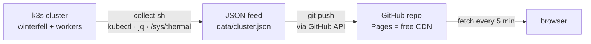

# mrtoadie.github.io

 [](https://mrtoadie.github.io) [](https://github.com/mrtoadie/mrtoadie.github.io/commits/main) [](https://github.com/mrtoadie/mrtoadie.github.io) [](data/cluster.json) 

# k3s on Raspberry Pi · self-hosted, self-broken, self-fixed

A personal portfolio and **live homelab dashboard**, served as a fully static site on GitHub Pages — no backend, no database, no framework. Real cluster metrics from a 4-node k3s cluster are collected on-site, pushed to this repository, and rendered client-side.

**→ [View the live site](https://mrtoadie.github.io)**

---

## What makes this more than a homepage

Most portfolio sites are static. This one is static _and_ live: the k3s cluster section shows real, near-real-time metrics for every node — CPU, RAM, disk, temperature, pod counts and uptime — updated every 5 minutes without a single server in the middle.

The trick is a **push-based data pipeline**:



1. A collector script runs on the control-plane node (`collect.sh` + systemd timer). It queries the Kubernetes API, parses node specs, resource usage and pod counts with `jq`, and writes `data/cluster.json`.
2. The feed is pushed to this repository via the GitHub API — no runner, no webhook, no inbound traffic.
3. The static page fetches the JSON client-side and renders gauges, node cards and cluster stats — pure HTML, CSS and vanilla JavaScript.
4. A dedicated **watcher device** (Raspberry Pi Zero 2W, fittingly named _watcher_) sits outside the cluster. It checks the API server independently and pushes its own heartbeat (`data/watcher.json`), so the dashboard can tell whether the cluster is down _or the collector itself_.

### Graceful degradation by design

The dashboard never lies to its visitors. When the collector cannot reach the API server, it writes the failure reason into the feed — and the frontend reacts:

- **LIVE badge** (green, pulsing): data comes straight from the cluster.
- **DEMO DATA badge** (amber): the feed carries a `collector_error` or is empty/stale; the page switches to bundled demo data and shows _why_ and _for how long_ — e.g. `no live data since 10 h`.
- **Watcher heartbeat**: older than 30 minutes (two missed beats) → watcher counts as offline.

The site stays fully functional even when the whole lab is powered off. That is deliberate: a portfolio dashboard that breaks whenever the Raspberry Pi does would not be much of a portfolio.


---

## Tech stack

| Layer      | Choice                                                                                   |
| ---------- | ---------------------------------------------------------------------------------------- |
| Hosting    | GitHub Pages (static)                                                                    |
| Frontend   | Vanilla HTML / CSS / JavaScript, GitHub-dark inspired theme                              |
| Diagrams   | Mermaid.js (data flow, rendered client-side)                                             |
| Data       | Plain JSON files in `data/`                                                              |
| Collection | `collect.sh` — kubectl + jq + shell, systemd timers                                      |
| Transport  | GitHub REST API commits (token auth)                                                     |
| Cluster    | k3s on 4× Raspberry Pi 4 (`winterfell` + 3 workers), control-plane data on USB-SSD (XFS) |
| Watcher    | Raspberry Pi Zero 2W, independent reachability check + heartbeat                         |
| Icons      | Iconify (self-hosted, no third-party font CDN)                                           |

No PHP, no database, no npm build step. If it can be done with a shell script and a static file, it is done with a shell script and a static file.

---

## Repository structure

```
mrtoadie.github.io/
├── index.html        # homelab dashboard (live cluster data)
├── projects.html     # selected projects
├── skills.html       # tech stack & experience
├── data/
│   ├── cluster.json  # node specs, resource usage, pod counts (pushed by collect.sh)
│   └── watcher.json  # watcher heartbeat (host, timestamp, uptime)
└── assets/           # icons, styles, images
```

## Related projects

- [`go-check-cert`](https://github.com/mrtoadie/go-check-cert) — Go tool for certificate validation
- [`kvm-configurator`](https://github.com/mrtoadie/kvm-configurator) — KVM setup automation
- [`go-velero-manager`](https://github.com/mrtoadie/go-velero-manager) — interactive Velero backup manager (Go + Charm Huh)

## Run it locally

```bash
git clone https://github.com/mrtoadie/mrtoadie.github.io.git
cd mrtoadie.github.io
python3 -m http.server 8080
# → http://localhost:8080
```

Any static file server works. Without a live feed present, the page automatically renders in demo mode.

---

_Curious minds who open the console are greeted properly. You know who you are._ 🐸
